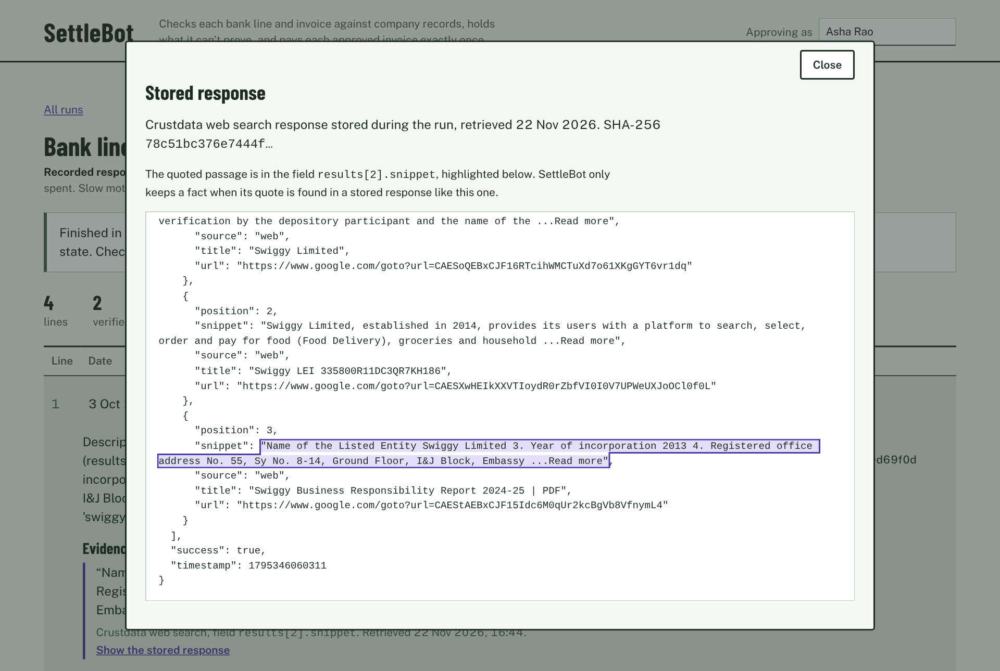
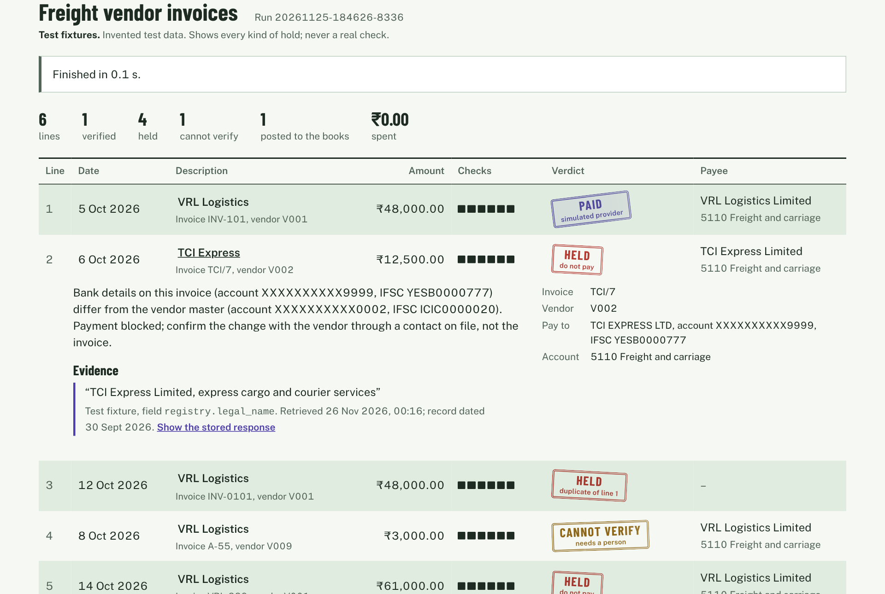
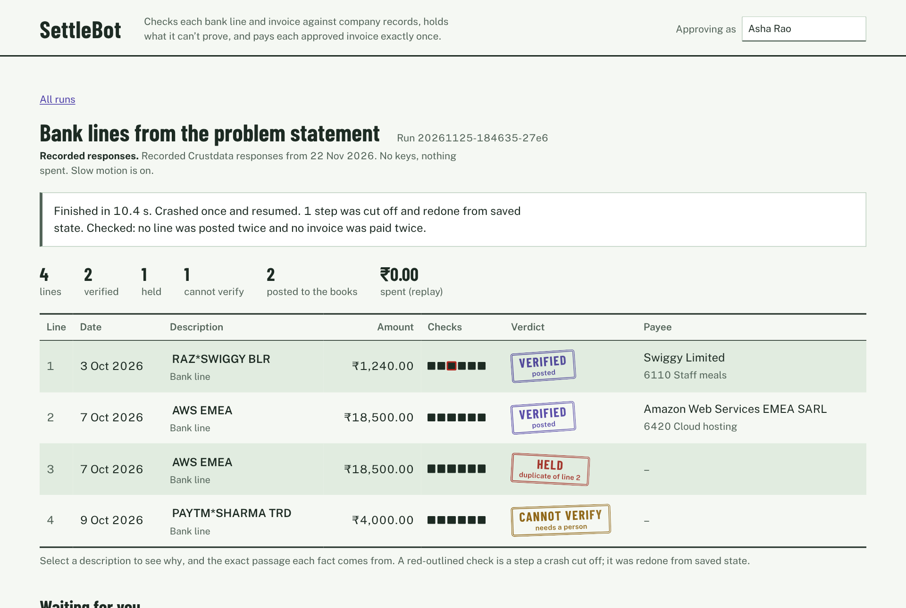
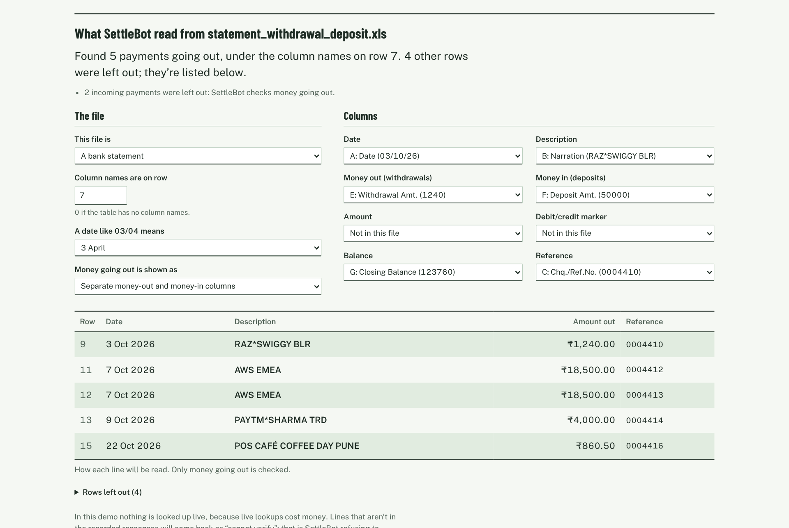
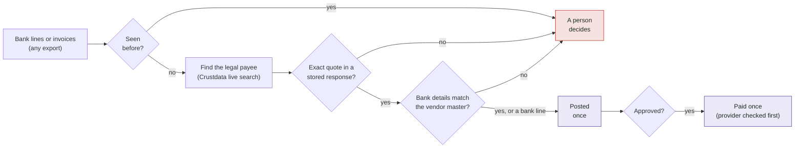

<div align="center">

# SettleBot

**Checks every bank line and invoice against live company data, holds what it can't prove,<br>and pays each approved invoice exactly once.**

[](https://github.com/INV777/Settlebot/actions/workflows/ci.yml)
[](evals/RESULTS.md)
[](https://settlebot-demo.onrender.com)
[](.python-version)

[**Try the live demo**](https://settlebot-demo.onrender.com) &nbsp;|&nbsp; [Run it locally](#run-it-locally) &nbsp;|&nbsp; [How it works](docs/how-it-works.md) &nbsp;|&nbsp; [Evaluation results](evals/RESULTS.md)

</div>


| ₹12 a line | 82 of 83 | 20 of 20 | ₹0 |
| :---: | :---: | :---: | :---: |
| charged only when no person was needed, against ₹50–200 an invoice outsourced | evaluation lines answered right, none of them unsafe | crash rounds with nothing posted or paid twice | to try the demo or read a file: no live calls, no AI |

The live demo runs on recorded and invented data with a simulated payment provider, so nothing real is checked, spent or paid. Free hosting sleeps when idle; the first visit can take a minute.

## What it does

Mid-size Indian logistics firms pay outside accounting firms to check and pay their bills. For each bank-statement line or vendor invoice, SettleBot:

1. **finds the real payee** from live sources, and keeps a fact only if its exact passage is in a stored response;
2. **posts it** to the right ledger account;
3. **holds** duplicates, changed bank details and lookalike vendors for a person;
4. **pays** only what a person approves, exactly once, even if the process is killed halfway.

Every line ends with one of four verdicts:

| Verdict | What it means |
| --- | --- |
| **Verified** | The payee and account are backed by a cited source. Posted once; invoices are paid after approval. |
| **Held: duplicate** | Matches an earlier line or invoice. Posted only if a person releases it. |
| **Held: do not pay** | The bank details differ from the vendor master, or the invoice imitates a known vendor. |
| **Cannot verify** | No source settles it. SettleBot says what is missing instead of guessing. |

## See it

<table>
<tr>
<td width="50%" valign="top"><br><b>Every fact has a source.</b> Open a line to see the exact passage in the stored API response.</td>
<td width="50%" valign="top"><br><b>Fraud and duplicates are held.</b> Changed bank details, lookalike vendors and re-sent invoices never reach payment.</td>
</tr>
<tr>
<td width="50%" valign="top"><br><b>A crash costs nothing.</b> Kill the worker mid-run; it resumes from saved state and never posts or pays twice.</td>
<td width="50%" valign="top"><br><b>Any export goes in.</b> Upload a statement as the bank gives it, check what was read, fix a column, run.</td>
</tr>
</table>

## Features

- **Cited answers.** Each verified fact names its source, the exact field or passage, the record date and when it was fetched.
- **Account coding** from the chart of accounts in config (Swiggy goes to 6110 Staff meals).
- **Fraud and duplicate holds.** Changed bank details, lookalike names (`VRL Logistlcs`) and sender domains (`vrlgr0up.in`), re-sent invoices (`INV-0101` is `INV-101`). The reason names the exact edit.
- **Exactly-once posting and payment** across `kill -9` restarts. A retry asks the payment provider before creating anything.
- **Any bank or accounts export.** Excel, old `.xls`, CSV or text, read offline without AI. Preview it and fix any column before a run.
- **Approval rules in config**, such as two approvers from ₹1,00,000. Decisions are stored and survive restarts.
- **Cost ledger and limits.** Every external call is logged in rupees. Past a cost or time limit, the remaining lines stop as "cannot verify".
- **Replay mode.** Real recorded Crustdata responses rerun with no key and no network.
- **Privacy.** Account numbers show only their last 4 digits, and personal details are masked before any text reaches Claude.

## Run it locally

No keys needed:

```bash
python -m pip install -r requirements.txt
python main.py console            # then open http://127.0.0.1:8000
```

Start a run on **Bank lines from the problem statement** with recorded responses, crash the worker halfway, resume it, and open a line to see the passage behind each fact. Or choose **Your own file** and upload a statement.

To check live data, put `CRUSTDATA_API_KEY` (and optionally `ANTHROPIC_API_KEY` and Razorpay **test** keys) in a `.env` file. [Running SettleBot](docs/running.md) covers the command line, the screening demo, the tests and hosting your own demo:

[](https://render.com/deploy?repo=https://github.com/INV777/Settlebot)

## How it works



Three rules shape it:

- **Claude proposes; code decides.** No fact comes from model memory. Claude may only point at text already fetched from a live source, and code checks that the quote is verbatim, names the company and matches the bank descriptor. Without a Claude key, SettleBot runs on rules alone.
- **"Cannot verify" beats a guess.** A careful clerk who isn't sure asks. Unknown payees, sources that disagree and limit breaches all go to a person, with the missing piece named, and are not billed.
- **Exactly once, not usually once.** Every step is checkpointed in SQLite. Each payment has a fixed receipt, and a retry looks it up at the provider before creating an order.

Architecture, data sources, crash recovery and privacy in full: [How SettleBot works](docs/how-it-works.md).

## How we know it works

- **Evaluation suite.** 40 hard cases (83 lines) an accounts clerk would recognise, scored +1 right, 0 for an honest "cannot verify" and −2 wrong. CI fails on any wrong or unsafe answer. [Results by category](evals/RESULTS.md).
- **Kill tests.** The worker is killed at random while checking and while paying; 20 of 20 rounds end with nothing posted or paid twice.
- **CI on Linux and Windows** runs 93 tests, the evaluation suite and both kill tests on every push and pull request.

## Why a 3PL would pay for it

| | Price per invoice |
| --- | --- |
| Outsourced, simple processing | ₹50–80 ([Pazy](https://www.pazy.io/blogs/outsource-ap-guide-india)) |
| Outsourced, with three-way matching and GST checks | ₹150–200 (same source) |
| In-house, fully loaded | about ₹120 ([Tally Solutions](https://tallysolutions.com/accounting/the-roi-of-accounts-payable-automation-calculating-the-cost-of-a-manual-invoice/)) |
| **SettleBot** | **₹12 per line, charged only for lines finished without a person** |

That is less than a quarter of the cheapest outsourced price, and every run prints its measured cost per line, revenue and margin against that benchmark.

## More

| Read | For |
| --- | --- |
| [Running SettleBot](docs/running.md) | Console, file formats, command line, screening demo, hosting, tests, live-fix cheat sheet, repository layout |
| [How SettleBot works](docs/how-it-works.md) | Architecture, data sources, how a line is decided, crash recovery, approvals and privacy, cost limits, evaluation |
| [Project notes](docs/project-notes.md) | History, changes since the hackathon, what we tried, design choices, prior art |
| [Evaluation results](evals/RESULTS.md) | Score by category, and every line not answered correctly |

Built by team DestructiblesYC at ContextCon 05, BITS Pilani, on 22 Nov 2026 ([submitted version](https://github.com/INV777/Settlebot/releases/tag/Hackathon)). Next: matching vendors on GSTIN, PAN and CIN instead of names, an account-holder name check before the first payment to new bank details, and scheduled re-checks of vendors.
