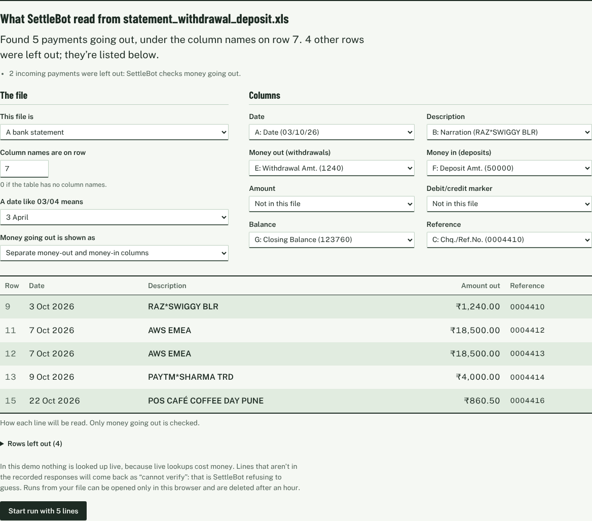
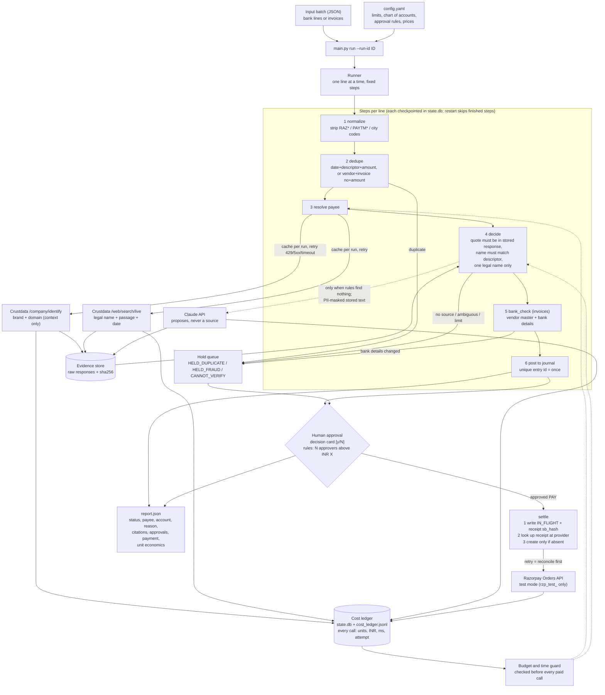

# SettleBot: payables and bank-line posting that pays each invoice exactly once

[](https://github.com/INV777/Settlebot/actions/workflows/ci.yml)

**Track:** Buying and paying (ContextCon 05, BITS Pilani: *Services, Replaced*)
**Client:** a mid-size Indian 3PL

**Project history:** built by team DestructiblesYC at ContextCon 05 on 22 Nov 2026 (the submitted version is the [`Hackathon` release](https://github.com/INV777/Settlebot/releases/tag/Hackathon)). Work since then is listed under [After the hackathon](#after-the-hackathon).

**Live demo: https://settlebot-demo.onrender.com** (free hosting: the first visit after a quiet spell takes about a minute to wake up). It runs on recorded and invented data with a simulated payment provider, so nothing real is checked, spent or paid.


**Try it with no keys:**

```bash
python -m pip install -r requirements.txt
python main.py console            # then open http://127.0.0.1:8000
```

Start a run on "Bank lines from the problem statement" with recorded responses, crash the worker halfway, resume it, then open a line to see the exact passage behind each fact. The recorded responses are real Crustdata API answers from 22 Nov 2026, so nothing is spent.

Or choose **Your own file** and upload a bank statement or a list of bills as your bank or accounts software exports it (Excel, CSV or text). SettleBot finds the table and the columns itself, without AI, and shows what it read before anything runs; any column it got wrong can be changed from a dropdown. [More below](#reading-any-export).

**Host your own public demo** on Render's free plan (no keys needed; it starts with two finished example runs):

[](https://render.com/deploy?repo=https://github.com/INV777/Settlebot)

**Contents:** [The service](#1-the-service) · [What it does now](#2-what-it-does-now) · [What comes next](#3-what-comes-next) · [How it runs](#4-how-it-runs) · [What we tried](#5-what-we-tried) · [Why this way](#6-why-this-way)

---

## 1. The service

**The job:** accounts-payable verification and settlement. Raw bank-statement lines or vendor invoices come in. For each one, SettleBot:

1. identifies the real payee from live sources;
2. posts it to the right ledger account;
3. holds duplicates and bank-detail fraud;
4. pays only what a person approves, exactly once, even if the process is killed half-way.

**Who does it today:** mid-size 3PLs send this work to outside firms (accounting BPOs, CA back-offices, freight audit and payment firms), which charge per invoice.

| | Price per invoice |
| --- | --- |
| Outsourced, simple processing | ₹50–80 ([Pazy, outsourcing AP in India](https://www.pazy.io/blogs/outsource-ap-guide-india)) |
| Outsourced, with three-way matching and GST checks | ₹150–200 (same source) |
| In-house, fully loaded | about ₹120 ([Tally Solutions](https://tallysolutions.com/accounting/the-roi-of-accounts-payable-automation-calculating-the-cost-of-a-manual-invoice/)) |
| **SettleBot** | **₹12 per line, charged only for lines finished without a person** |

That is less than a quarter of the cheapest outsourced price. Every run prints our measured cost per line, revenue and margin against that benchmark.

---

## 2. What it does now

### Input

A JSON array of bank lines and invoices. A line without `invoice_no` or `vendor_id` is treated as a bank line.

```json
[
  {"date": "2026-10-03", "description": "RAZ*SWIGGY BLR", "amount_inr": 1240},
  {"kind": "invoice", "invoice_no": "INV-101", "vendor_id": "V001", "date": "2026-10-05",
   "description": "VRL Logistics", "amount_inr": 48000,
   "bank_account": {"account_number": "50100123450001", "ifsc": "HDFC0000123", "name": "VRL LOGISTICS LIMITED"}}
]
```

<a id="reading-any-export"></a>**Or any export, as it comes.** The console (and `settlebot/importer.py`) reads a bank statement or a list of bills straight from the bank or the accounts software: `.xlsx`, old `.xls`, the HTML pages some banks save as `.xls`, and CSV or text with any delimiter or encoding. Everything is offline rules, with no network and no AI, so reading a file costs nothing.

- **Finds the table:** skips the account details above it and the totals below it, picks the right sheet, and works without column names.
- **Finds the columns:** from common headings ("Withdrawal Amt.", "Narration", "Dr/Cr", "Bill No", "Supplier"), and when there are none, from the numbers themselves: the column the balance moves by is the amount.
- **Cleans the values:** Indian amounts (`1,18,500.00`, `500.00 Dr`, `(860.50)`), dates in any common format, with day-first or month-first worked out from the file.
- **Keeps only what it should check:** money going out. Money coming in and opening, closing and total rows are left out and listed.
- **Shows its reading first:** a preview of each line with its row number in the file, and a dropdown for every column, the sheet, the header row, the date order and how money out is shown. A run can't start while a needed column is missing.



### Output

`out/<run-id>/report.json` gives one row per line, and the same table prints to the terminal.

| Status | Meaning | Posted? | Paid? |
| --- | --- | --- | --- |
| `VERIFIED` | Legal payee and account backed by a cited source | Yes, once | Invoices, after approval |
| `HELD_DUPLICATE` | Same date, descriptor and amount as an earlier line (invoices: same vendor, invoice number and amount) | Only if a person releases it | No |
| `HELD_FRAUD` | Invoice bank details differ from the vendor master, or the invoice imitates a known vendor | No | Never from this batch |
| `CANNOT_VERIFY` | No source settles the payee, sources disagree, or a limit was reached; names what is missing | No | No |

Each fact cites the source, the URL, the exact field or passage, the record date where the source gives one, and when it was retrieved. Example from a real run: payee **Swiggy Limited**, from `results[2].snippet`, which reads "Name of the Listed Entity Swiggy Limited…" in a Crustdata web search response, retrieved 22 Nov 2026.

### What works today

- **Live payee resolution** through Crustdata (company identify + live web search), with a verbatim citation for every verified fact.
- **Account coding** from the chart of accounts in config (live example: Swiggy → 6110 Staff meals).
- **Duplicate holds** for bank lines and invoices (`INV-0101` and `INV-101` are the same invoice; `INV-1001` is not).
- **Fraud holds:** changed bank details, lookalike vendor names ("VRL Logistlcs") and lookalike sender domains (`vrlgr0up.in` vs `vrlgroup.in`). The hold reason names the exact edit: a letter dropped, 0 for o, a different ending, the same name with a different legal form.
- **Human approval** through decision cards, with approval rules in config (for example, two approvers above ₹1,00,000).
- **Exactly-once posting and payment** across `kill -9` restarts, settled through Razorpay Orders in **test mode only**.
- **Cost ledger and limits:** every external call is logged in INR; past the cost or time limit, remaining lines fail closed.
- **PII masking** before any text reaches Claude.

### Evaluation suite

[`evals/cases.yaml`](evals/cases.yaml) holds 40 hard cases (83 lines), each with the answer a careful AP clerk would give: processor prefixes, double charges and monthly repeats, zero-padded and re-sent invoices, new bank accounts, lookalike names (swapped letters, `1` for `i`, Cyrillic letters, another legal form), lookalike sender domains, unknown vendors, limits, the problem statement on real recorded Crustdata responses, and eight messy files to read (an old Excel statement with totals, a semicolon CSV in Windows encoding, a two-sheet workbook, an HTML page saved as `.xls`, a UTF-16 text export, a file with no column names, dates that could go either way, and a list of bills with a missing vendor ID). `python scripts/eval.py` runs them through the real pipeline in about 2 s and scores **+1** for correct, **0** for an honest "cannot verify", and **−2** for anything else. An answer is **unsafe** when SettleBot says VERIFIED and the right answer was anything else. CI fails on any wrong or unsafe answer.

Current score: **82 of 83**, with no wrong or unsafe answers ([full results](evals/RESULTS.md)). The one miss is a documented limit: a city that `descriptor.city_tokens` doesn't list stays in the merchant name, so the line is held rather than guessed.

The suite earned its place on its first run: it found a re-sent invoice with a changed amount that was VERIFIED and payable (now held), and a missing "same vendor under a new ID" note (now given).

### Pass mark, and how we check it

| Requirement | How it is checked | Result |
| --- | --- | --- |
| Every `VERIFIED` fact is sourced: its quote appears verbatim in a response stored during the run | `grounding.py` on every fact; tests replay real Crustdata responses | 46 tests and the 32-case evaluation suite pass offline; CI runs both on every push |
| Duplicates are never posted or paid; changed bank details are blocked; an unidentifiable payee gives `CANNOT_VERIFY`, not a guess | Fixture batches in `tests/` (`PAYTM*SHARMA TRD` must end as cannot verify) | Pass |
| Restarts are exactly-once | `scripts/kill_test.py --rounds 20` (kills during verification) and `--pay --rounds 20` (kills during payment) | 20/20 rounds in each. In the payment test, 8 kills landed after the order reached Razorpay but before it was recorded; each restart adopted the order |
| Limits hold: cost under `limits.max_cost_inr`, active time under `limits.max_time_seconds` | Guard checks before every paid call | Remaining lines fail closed to `CANNOT_VERIFY` |

---

## 3. What comes next

### After the hackathon

**Done**

- **Claude calls are priced in rupees again.** A broken price block in `config.yaml` had logged every Claude call at ₹0, so the cost limit ignored model spend. Prices are now ₹9.33 in / ₹46.67 out per million tokens (USD 0.10 / 0.50 for `claude-haiku-5-5` × RBI reference rate 93.3461 on 19 Nov 2026), with a regression test.
- **Duplicate invoices are explained correctly.** The hold reason now says "same vendor, invoice number and amount" for invoices, and keeps "same date, descriptor and amount" for bank lines.
- **Payment runs no longer hang in Windows scripts.** With input redirected from `NUL`, Windows reports a terminal, so `run --pay` waited on a prompt nobody could answer and crashed. SettleBot now checks for a real console, and an unanswered prompt always leaves the action pending. CI found this on its first run.
- **CI** runs the tests and both kill tests (verification and payment) on Linux and Windows for every push and pull request.
- **Web console** (`python main.py console`). Start a run, watch each line's checks, crash the worker and resume it, approve or reject, pay approved invoices, and read the cost ledger. Each run is its own `main.py run` process, so "Crash the worker" is a real kill. "Show the stored response" opens the raw API answer with the cited field highlighted. See [Run it](#run-it).
- **Replay mode** (`--replay`). Reruns real recorded Crustdata responses with no key and no network. Ledger rows say `crustdata-replay` at ₹0, citations keep the original fetch time, and the report estimates what the same calls cost live. `scripts/export_cassette.py` turns any live run into a replay.
- **Fixed: a second run could pay for the same call twice after a crash.** Stored responses were keyed without the run, so a second run with an identical response lost its cache row, and a crash in that run would have repeated the call. Keys now include the run; the regression test fails on the old code.
- **Evaluation suite** with a score in CI ([above](#evaluation-suite)). Its first run found two problems, both fixed with regression tests: an invoice re-sent with the same number and a **different amount** was VERIFIED and payable (it is now held for a person, with both amounts in the reason), and an invoice under a new vendor ID with a known vendor's exact name was held without saying so (names are now compared without any legal form).
- **Reads any bank or accounts export, for ₹0.** Upload a statement or a list of bills as it comes, preview what was read, fix any column from a dropdown, then run ([how it reads a file](#reading-any-export)). Offline rules only, no AI. Eight invented messy files are scored in CI. In the public demo, runs from your own file open only in the browser that started them, are deleted after an hour, and the uploaded file is not kept once the run starts.
- **Two approvers from ₹1,00,000.** A second `PAY` rule in `config.yaml`; the comment there now matches the code (the highest matching threshold decides).

**Still open**

- Replace the fictional vendor master (`data/vendor_master.json`), chart of accounts and limits with a real client's records.
- Set the real INR price per Crustdata credit (`crustdata.inr_per_credit` is still a volume-tier placeholder of ₹0.93).

**Planned**

- **Match on registry IDs, not names.** Use GSTIN, PAN and CIN as the join key between invoice, vendor master and live sources (the vendor master already has a `gstin` field).
- **Bank-account name check.** Confirm that the account holder's name matches the vendor before the first payment to new bank details, using a provider's account-validation API.
- **Continuous re-checks.** Re-verify vendors on a schedule with Crustdata Watch, so a status change raises a hold before the next payment run.
- **Outcome billing.** Turn the per-run unit-economics line into actual metered billing: charge only for lines finished without a person.
- **Production payments.** Move from Razorpay test mode to live settlement, behind the same approval rules and reconcile-before-retry logic.

---

## 4. How it runs

### Architecture



(Source: `architecture.mmd`.)

### Data sources the service calls

| Source | What we take from it | Mode | Cost logged as |
| --- | --- | --- | --- |
| Crustdata `POST /company/identify` | Brand name and primary domain, used as context only (confidence ≥ 0.9) | Live | credits → INR |
| Crustdata `POST /web/search/live` | The legal name, the passage that states it, and the page date | Live | credits → INR |
| Vendor master (client record, `vendor_master` in config) | Vendor ID, legal name, bank account, IFSC and domains on file | Client file | — |
| Anthropic Claude API (`llm.model`, default `claude-haiku-5-5`) | **Not a source.** It only proposes which stored result names the payee, or which account fits; code checks every proposal | Live | tokens → INR |
| Razorpay Orders API | Settlement of approved invoices | **Test mode only** (`rzp_test_` keys; live keys are refused) | calls |

### How a line is decided

Six steps, each checkpointed:

1. **Normalize** the descriptor: `RAZ*SWIGGY BLR` becomes merchant `SWIGGY` (processor Razorpay, city BLR).
2. **Dedupe** against earlier lines.
3. **Resolve** the payee. Crustdata identify runs first, then live web search, with results cached per run.
4. **Decide.** A candidate legal name is kept only if:
   - its passage is verbatim in the stored response;
   - the passage contains the name;
   - the passage ties the name to the descriptor, either as a defined term (`Amazon Web Services EMEA SARL ("AWS EMEA")`) or by containing every merchant word (`Swiggy Limited`).

   Two different legal names means `CANNOT_VERIFY`. People, the payment processor and lookalikes never qualify, which is why `PAYTM*SHARMA TRD` ends as cannot verify. Claude only fills gaps the rules leave, and its output passes the same checks.
5. **Bank check** for invoices: the vendor must be in the master, the live legal name must match the master, and the bank details must match. Lookalike names under an unknown vendor ID, and lookalike sender domains, are held as fraud. On bank lines, an unverified descriptor that resembles a known payee (`SW1GGY`) says so and is never matched to that payee.
6. **Post** to the journal with a unique entry ID, so each line posts once.

### Crash recovery

- **State:** SQLite in WAL mode (`state.db`). Each step's output and its local side effects commit in one transaction. A restart skips finished steps and reuses cached source responses, so it pays nothing extra for them.
- **Item keys** come from the input file's hash plus the line number, so two identical lines never collide.
- **Payments:**
  1. Write `IN_FLIGHT` with receipt `sb_` + 32 hex characters (under Razorpay's 40-character limit).
  2. On restart, look up the receipt at Razorpay first, and adopt the order if it exists.
  3. Create a new order only if none exists.

### Approvals and privacy

- Nothing irreversible happens without a person. Each pending action shows a **decision card** with the payee, masked bank details, the plain-English reason and the sources. Decisions are stored with approver, time and reason, and survive restarts.
- Approval rules are in config, for example `{action: PAY, min_amount_inr: 100000, approvers: 2}`. The same person approving twice counts once.
- A `HELD_FRAUD` line never gets a payment action. The fix is to confirm the change with the vendor through a contact on file, never through the invoice.
- Uploaded files are read in memory and kept only until the run starts; then only the extracted lines remain. Previews show account and card numbers with only the last 4 digits.
- `pii_guard` masks PAN, Aadhaar, phone numbers, email, IFSC, UPI IDs and account numbers before any text goes to Claude. Account numbers in reasons and cards show only the last 4 digits.

### Cost and limits

Every external call writes a ledger row with provider, operation, units, INR cost, latency, attempt number and whether it was a cache hit. The ledger lives in `state.db` and is exported to `out/<run-id>/cost_ledger.jsonl`. The guard checks spend and active time before every paid call. Each run prints a unit-economics line: measured cost per line, price, revenue and margin.

### Run it

**Screening demo** (one command; works in Windows PowerShell):

```bash
python scripts/demo.py             # live: Crustdata + Razorpay test mode (needs .env)
python scripts/demo.py --pause     # waits for Enter before each step, with interactive decision cards
python scripts/demo.py --offline   # same flow on fixtures and a fake provider, no network
```

The demo runs five steps: verify and post the bank lines; `kill -9` mid-run and restart with the same run ID (shows postings = 2, the steps redone, the cached responses reused); invoice holds (fraud, duplicate, unknown vendor, lookalike domain, lookalike name); approve line 1 and pay, then pay again to show nothing changes; print the last cost-ledger rows. `scripts/demo.sh` is the same demo for bash. On Windows, if `pip.exe` is blocked, use `python -m pip install -r requirements.txt`.

**Web console** (recommended):

```bash
python -m pip install -r requirements.txt
python main.py console                     # http://127.0.0.1:8000
python main.py console --demo              # public demo: replay and fixtures only, simulated payments
```

| Data mode | What it uses | Keys |
| --- | --- | --- |
| Recorded responses | Real Crustdata answers recorded on 22 Nov 2026 (`tests/fixtures/crustdata_recorded.json`) | None |
| Test fixtures | Invented records that trigger every kind of hold; never a real check | None |
| Live | Crustdata, plus Claude if `ANTHROPIC_API_KEY` is set; payments in Razorpay test mode if test keys are set | `.env` |

Runs and their database live in `console_data/` (git-ignored). Payments go to a simulated provider unless the run is live and Razorpay test keys are set.

**Public demo on Render:** `render.yaml` describes one free web service that runs `python main.py console --demo` on Python 3.12 (`.python-version`). Demo mode allows only recorded and fixture data, pays a simulated provider, takes files up to 2 MB and 300 lines, runs three workers at a time, and starts with one finished run of each sample. **It cannot spend money:** workers start with every API key blanked (so even a `.env` file can't supply one), with `--no-llm`, and with replay or fixture data only; a test checks this with keys set. Runs from a visitor's own file open only in that browser (a random id kept in its local storage) and are deleted, database rows included, after an hour. Free instances sleep after 15 idle minutes and take about a minute to wake, and the disk is temporary, so runs are cleared whenever the instance restarts.

**Quickstart (command line):**

```bash
python3 -m venv .venv && source .venv/bin/activate
pip install -r requirements.txt
cp .env.example .env    # add CRUSTDATA_API_KEY, ANTHROPIC_API_KEY (optional), RAZORPAY_KEY_ID/SECRET (test)

python main.py run tests/fixtures/pdf_example_bank_lines.json --run-id oct-2026-run1    # verify and post
python main.py approve --run-id oct-2026-run1                                             # decision cards
python main.py run tests/fixtures/pdf_example_bank_lines.json --run-id oct-2026-run1 --pay  # settle (test mode)
python main.py report --run-id oct-2026-run1                                              # re-print report
python main.py run tests/fixtures/pdf_example_bank_lines.json --run-id replay-1 --replay    # recorded responses, no keys
```

**Tests** (offline, fixtures and recorded real responses):

```bash
python -m pytest -q
python scripts/kill_test.py --rounds 20
python scripts/kill_test.py --pay --rounds 20
python scripts/smoke_live.py      # live check of Crustdata, Claude and Razorpay test mode (no side effects)
```

`--fake` runs use fixture sources and are for tests only. They never make a real decision.

### Live-fix cheat sheet

| Change request | Where |
| --- | --- |
| New cost or time limit | `limits.max_cost_inr`, `limits.max_time_seconds` |
| Second approver above ₹X | Add `{action: PAY, min_amount_inr: X, approvers: 2}` to `approvals.rules` |
| New account or mapping | `chart_of_accounts` |
| New processor prefix (e.g. `PHONEPE*`) | `descriptor.processor_prefixes` |
| New output field | `output.extra_fields`, plus the report builder |
| Switch Claude model | `llm.model`, plus `llm.price_inr_per_mtok` |
| New vendor domain on file | `domains` in the vendor master |

### Repository layout

```
main.py                 CLI: run, approve, report, console
config.yaml             everything a live fix may change
settlebot/
  runner.py             steps, checkpoints, settlement
  store.py              SQLite WAL schema and transactions
  sources/              crustdata.py (identify, web search), fake.py (tests)
  entities.py           legal-name extraction and descriptor corroboration
  grounding.py          quote-in-source check
  llm.py                Claude proposer behind deterministic gates
  vendors.py            vendor master and bank-change hold
  lookalike.py          names the edit between a known name/domain and a candidate
  approvals.py          rules, decision cards
  payments.py           Razorpay Orders (test) and reconcile-before-retry
  ledger.py, report.py, pii_guard.py, normalize.py, accounts.py
  importer.py           reads raw bank and accounts exports (Excel, CSV, text) offline, no AI
  web/                  console: app.py (FastAPI API), workers.py (one process per run), static/ (page)
tests/                  unit and console tests, recorded Crustdata responses, fixtures,
                        and fixtures/imports/ (invented messy exports the importer is scored on)
evals/                  evaluation cases, fictional sources and vendor master, RESULTS.md
scripts/                demo.py / demo.sh, kill_test.py, smoke_live.py, export_cassette.py, eval.py,
                        make_import_samples.py (rebuilds the messy test files)
docs/screenshots/       console screenshots and the demo GIF
architecture.mmd        system diagram
data/vendor_master.json fictional placeholder until the client's records are in
```

---

## 5. What we tried

| We tried | What happened | What we do now |
| --- | --- | --- |
| `temperature: 0` for repeatable Claude answers | The live smoke test showed the current Anthropic SDK does not take a temperature argument | Determinism comes from forced tool calls, per-run caching of every answer, and code checks on every proposal |
| Letting Claude pick the ledger account from its own knowledge | Its answer was not tied to any source | Claude now gets the cited passages and classifies from those (live: Swiggy → 6110 Staff meals) |
| Taking the legal name from page titles | Titles carry brand names and marketing text, not the legal entity | Sentences that state a legal name ("Name of the Listed Entity…") rank above titles |
| Using Crustdata company identify as the payee source | It gives a brand and a domain, not the legal entity that gets paid | Identify is context only (confidence ≥ 0.9); the legal name comes from live web search, with the passage |
| Invoice duplicates keyed on date | A re-sent invoice with a new date would slip through | Key on vendor + normalized invoice number + amount (`INV-0101` = `INV-101`, `INV-1001` stays distinct) |
| Lookalike detection by generating permutations, as dnstwist does | A forward list can say "suspicious" but not why | `lookalike.py` compares the two values in reverse and names the exact edit, so the hold reason is readable |
| Entity rules with a fixed list of suffixes | Missed foreign forms such as Sdn Bhd, Pty Ltd and S.p.A. | Added them; names the rules still miss fall to Claude behind the same checks |
| `SIGKILL` in the kill test and a bash-only demo | Neither worked on a Windows laptop | `Popen.kill()` (TerminateProcess on Windows), a Python demo for PowerShell, LF endings via `.gitattributes`, console output safe for non-ASCII text |
| Leaving the outsourced benchmark blank until sourced | Margin had nothing to compare against | Sourced ₹50 per invoice (low end of Pazy's ₹50–80) and the ₹120 in-house figure from Tally |

We also added `tests/test_no_secrets.py`, which fails the suite if an API key appears in any tracked file.

---

## 6. Why this way

- **Claude proposes; code decides.** In payables, a wrong payee is money gone. So no fact comes from model memory: Claude only points at text already stored from a live source, and code checks that the quote is verbatim, names the entity and matches the descriptor. With no Anthropic key, the service still runs on rules alone and fails closed.
- **"Cannot verify" beats a guess.** An outsourced clerk who isn't sure asks; SettleBot does the same. Ambiguous sources, unknown payees and limit breaches all land in `CANNOT_VERIFY` with the missing piece named, and are not billed.
- **Never pay on a name alone.** Payment needs a vendor-master ID, a matching live legal name and matching bank details. Bank-detail changes and lookalikes are the classic invoice-fraud routes, so they hold by default.
- **Exactly-once over "usually once".** A crash between "order sent" and "order recorded" is exactly when double payments happen. Deterministic receipts plus look-up-before-create make every retry safe, and the kill tests prove it under random kills.
- **SQLite instead of a workflow engine.** One file, no extra services, and WAL transactions give us checkpointed steps with the same guarantees we needed from DBOS-style durable execution, on a laptop.
- **Everything a judge might change lives in `config.yaml`.** Limits, approval rules, accounts, prefixes and prices are one-line live fixes, not code changes.
- **Priced on outcomes.** We charge only for lines finished without a person, so our margin depends on getting lines right, not on touching more of them.
- **Haiku by default.** Claude is called only for gaps the rules leave, so a small, cheap model is enough, and every token is in the cost ledger.

### Prior art

| Idea | Where it came from | Licence | What we reused |
| --- | --- | --- | --- |
| Lookalike categories and homoglyph folding | [dnstwist](https://github.com/elceef/dnstwist) | Apache-2.0 | The categories and the confusable-character idea. No code: dnstwist generates permutations forward, while `lookalike.py` compares two values in reverse to name the edit |
| Per-field evidence (source, passage, date, confidence) | [Parallel Task API "Basis"](https://docs.parallel.ai/task-api/guides/access-research-basis) | Docs | The shape of a citation record |
| Exactly-once steps with idempotency keys | [DBOS Transact](https://github.com/DBOS-project/dbos-transact-py) | MIT | The pattern only (checkpoint each step, key each external action) |
| Approval gate before risky calls | [HumanLayer](https://github.com/humanlayer/humanlayer) | Apache-2.0 | The pattern only (decision stored, resumable after restart) |
