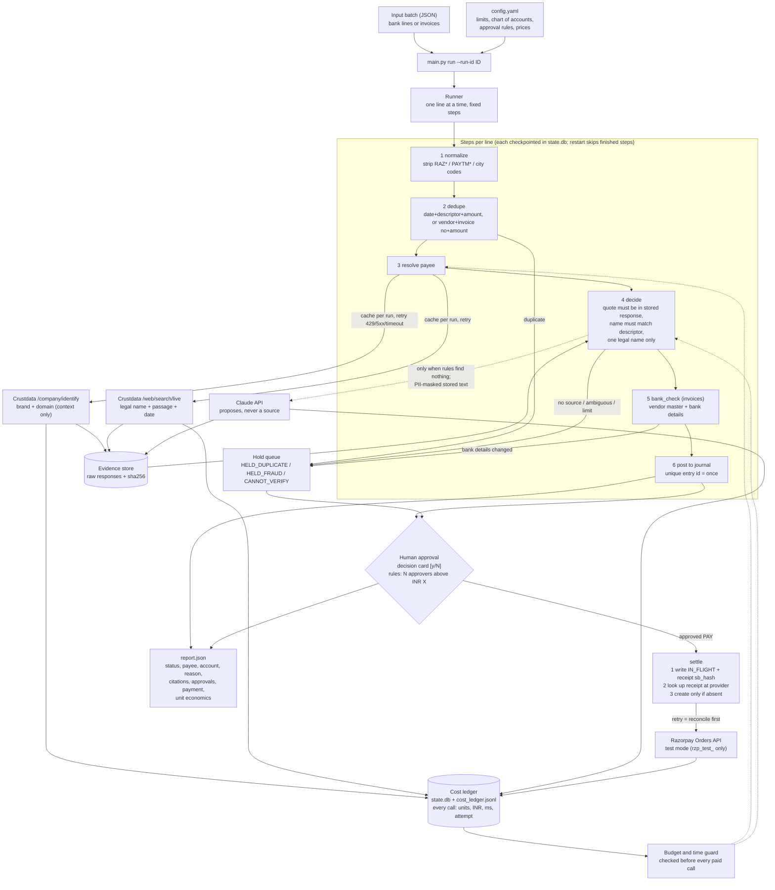

# How SettleBot works

[Back to the README](../README.md)

- [Architecture](#architecture)
- [Data sources the service calls](#data-sources-the-service-calls)
- [How a line is decided](#how-a-line-is-decided)
- [Crash recovery](#crash-recovery)
- [Approvals and privacy](#approvals-and-privacy)
- [Cost and limits](#cost-and-limits)
- [Evaluation suite](#evaluation-suite)
- [Pass mark, and how we check it](#pass-mark-and-how-we-check-it)

## Architecture

(Source: [`architecture.mmd`](../architecture.mmd).)

## Data sources the service calls

| Source | What we take from it | Mode | Cost logged as |
| --- | --- | --- | --- |
| Crustdata `POST /company/identify` | Brand name and primary domain, used as context only (confidence ≥ 0.9) | Live | credits → INR |
| Crustdata `POST /web/search/live` | The legal name, the passage that states it, and the page date | Live | credits → INR |
| Vendor master (client record, `vendor_master` in config) | Vendor ID, legal name, bank account, IFSC and domains on file | Client file | — |
| Anthropic Claude API (`llm.model`, default `claude-haiku-5-5`) | **Not a source.** It only proposes which stored result names the payee, or which account fits; code checks every proposal | Live | tokens → INR |
| Razorpay Orders API | Settlement of approved invoices | **Test mode only** (`rzp_test_` keys; live keys are refused) | calls |

## How a line is decided

Six steps, each checkpointed:

1. **Normalize** the descriptor: `RAZ*SWIGGY BLR` becomes merchant `SWIGGY` (processor Razorpay, city BLR).
2. **Dedupe** against earlier lines.
3. **Resolve** the payee. Crustdata identify runs first, then live web search, with results cached per run.
4. **Decide.** A candidate legal name is kept only if:
   - its passage is verbatim in the stored response;
   - the passage contains the name;
   - the passage ties the name to the descriptor, either as a defined term (`Amazon Web Services EMEA SARL ("AWS EMEA")`) or by containing every merchant word (`Swiggy Limited`).

   Two different legal names means `CANNOT_VERIFY`. People, the payment processor and lookalikes never qualify, which is why `PAYTM*SHARMA TRD` ends as cannot verify. Claude only fills gaps the rules leave, and its output passes the same checks.
5. **Bank check** for invoices: the vendor must be in the master, the live legal name must match the master, and the bank details must match. Lookalike names under an unknown vendor ID, and lookalike sender domains, are held as fraud. On bank lines, an unverified descriptor that resembles a known payee (`SW1GGY`) says so and is never matched to that payee.
6. **Post** to the journal with a unique entry ID, so each line posts once.

Files from a bank or accounts package are read before step 1 by `settlebot/importer.py`: offline rules, no network and no AI. See [What you can give it](running.md#what-you-can-give-it).

## Crash recovery

- **State:** SQLite in WAL mode (`state.db`). Each step's output and its local side effects commit in one transaction. A restart skips finished steps and reuses cached source responses, so it pays nothing extra for them.
- **Item keys** come from the input file's hash plus the line number, so two identical lines never collide.
- **Payments:**
  1. Write `IN_FLIGHT` with receipt `sb_` + 32 hex characters (under Razorpay's 40-character limit).
  2. On restart, look up the receipt at Razorpay first, and adopt the order if it exists.
  3. Create a new order only if none exists.

## Approvals and privacy

- Nothing irreversible happens without a person. Each pending action shows a **decision card** with the payee, masked bank details, the plain-English reason and the sources. Decisions are stored with approver, time and reason, and survive restarts.
- Approval rules are in config, for example `{action: PAY, min_amount_inr: 100000, approvers: 2}`. The same person approving twice counts once.
- A `HELD_FRAUD` line never gets a payment action. The fix is to confirm the change with the vendor through a contact on file, never through the invoice.
- Uploaded files are read in memory and kept only until the run starts; then only the extracted lines remain. Previews show account and card numbers with only the last 4 digits.
- `pii_guard` masks PAN, Aadhaar, phone numbers, email, IFSC, UPI IDs and account numbers before any text goes to Claude. Account numbers in reasons and cards show only the last 4 digits.

## Cost and limits

Every external call writes a ledger row with provider, operation, units, INR cost, latency, attempt number and whether it was a cache hit. The ledger lives in `state.db` and is exported to `out/<run-id>/cost_ledger.jsonl`. The guard checks spend and active time before every paid call. Each run prints a unit-economics line: measured cost per line, price, revenue and margin.

## Evaluation suite

[`evals/cases.yaml`](../evals/cases.yaml) holds 40 hard cases (83 lines), each with the answer a careful AP clerk would give: processor prefixes, double charges and monthly repeats, zero-padded and re-sent invoices, new bank accounts, lookalike names (swapped letters, `1` for `i`, Cyrillic letters, another legal form), lookalike sender domains, unknown vendors, limits, the problem statement on real recorded Crustdata responses, and eight messy files to read (an old Excel statement with totals, a semicolon CSV in Windows encoding, a two-sheet workbook, an HTML page saved as `.xls`, a UTF-16 text export, a file with no column names, dates that could go either way, and a list of bills with a missing vendor ID). `python scripts/eval.py` runs them through the real pipeline in about 2 s and scores **+1** for correct, **0** for an honest "cannot verify", and **−2** for anything else. An answer is **unsafe** when SettleBot says VERIFIED and the right answer was anything else. CI fails on any wrong or unsafe answer.

Current score: **82 of 83**, with no wrong or unsafe answers ([full results](../evals/RESULTS.md)). The one miss is a documented limit: a city that `descriptor.city_tokens` doesn't list stays in the merchant name, so the line is held rather than guessed.

The suite earned its place on its first run: it found a re-sent invoice with a changed amount that was VERIFIED and payable (now held), and a missing "same vendor under a new ID" note (now given).

## Pass mark, and how we check it

| Requirement | How it is checked | Result |
| --- | --- | --- |
| Every `VERIFIED` fact is sourced: its quote appears verbatim in a response stored during the run | `grounding.py` on every fact; tests replay real Crustdata responses | 93 tests and the 40-case evaluation suite pass offline; CI runs both on Linux and Windows for every push |
| Duplicates are never posted or paid; changed bank details are blocked; an unidentifiable payee gives `CANNOT_VERIFY`, not a guess | Fixture batches in `tests/` (`PAYTM*SHARMA TRD` must end as cannot verify) | Pass |
| Restarts are exactly-once | `scripts/kill_test.py --rounds 20` (kills during verification) and `--pay --rounds 20` (kills during payment) | 20/20 rounds in each. In the payment test, 8 kills landed after the order reached Razorpay but before it was recorded; each restart adopted the order |
| Limits hold: cost under `limits.max_cost_inr`, active time under `limits.max_time_seconds` | Guard checks before every paid call | Remaining lines fail closed to `CANNOT_VERIFY` |
