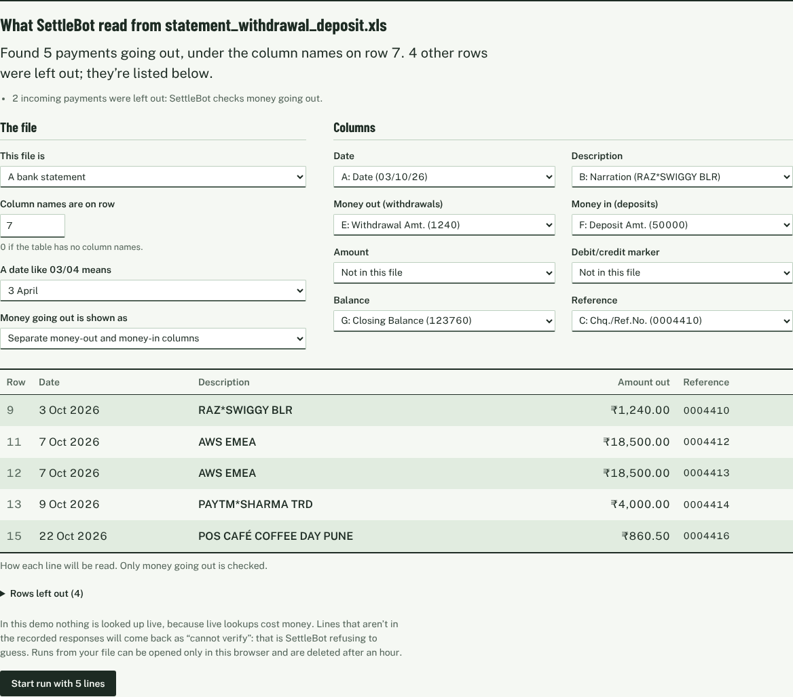

# Running SettleBot

[Back to the README](../README.md)

- [The web console](#the-web-console)
- [What you can give it](#what-you-can-give-it)
- [What comes out](#what-comes-out)
- [Command line](#command-line)
- [Screening demo](#screening-demo)
- [Public demo on Render](#public-demo-on-render)
- [Tests](#tests)
- [Live-fix cheat sheet](#live-fix-cheat-sheet)
- [Repository layout](#repository-layout)

## The web console

```bash
python -m pip install -r requirements.txt
python main.py console                     # http://127.0.0.1:8000
python main.py console --demo              # public demo: replay and fixtures only, simulated payments
```

| Data mode | What it uses | Keys |
| --- | --- | --- |
| Recorded responses | Real Crustdata answers recorded on 22 Nov 2026 (`tests/fixtures/crustdata_recorded.json`) | None |
| Test fixtures | Invented records that trigger every kind of hold; never a real check | None |
| Live | Crustdata, plus Claude if `ANTHROPIC_API_KEY` is set; payments in Razorpay test mode if test keys are set | `.env` |

Runs and their database live in `console_data/` (git-ignored). Payments go to a simulated provider unless the run is live and Razorpay test keys are set.

## What you can give it

**Any bank or accounts export, as it comes.** The console (and `settlebot/importer.py`) reads a bank statement or a list of bills straight from the bank or the accounts software: `.xlsx`, old `.xls`, the HTML pages some banks save as `.xls`, and CSV or text with any delimiter or encoding. Everything is offline rules, with no network and no AI, so reading a file costs nothing.

- **Finds the table:** skips the account details above it and the totals below it, picks the right sheet, and works without column names.
- **Finds the columns:** from common headings ("Withdrawal Amt.", "Narration", "Dr/Cr", "Bill No", "Supplier"), and when there are none, from the numbers themselves: the column the balance moves by is the amount.
- **Cleans the values:** Indian amounts (`1,18,500.00`, `500.00 Dr`, `(860.50)`), dates in any common format, with day-first or month-first worked out from the file.
- **Keeps only what it should check:** money going out. Money coming in and opening, closing and total rows are left out and listed.
- **Shows its reading first:** a preview of each line with its row number in the file, and a dropdown for every column, the sheet, the header row, the date order and how money out is shown. A run can't start while a needed column is missing.



**Or a JSON batch**, an array of bank lines and invoices. A line without `invoice_no` or `vendor_id` is treated as a bank line.

```json
[
  {"date": "2026-10-03", "description": "RAZ*SWIGGY BLR", "amount_inr": 1240},
  {"kind": "invoice", "invoice_no": "INV-101", "vendor_id": "V001", "date": "2026-10-05",
   "description": "VRL Logistics", "amount_inr": 48000,
   "bank_account": {"account_number": "50100123450001", "ifsc": "HDFC0000123", "name": "VRL LOGISTICS LIMITED"}}
]
```

## What comes out

`out/<run-id>/report.json` gives one row per line, and the same table prints to the terminal.

| Status | Meaning | Posted? | Paid? |
| --- | --- | --- | --- |
| `VERIFIED` | Legal payee and account backed by a cited source | Yes, once | Invoices, after approval |
| `HELD_DUPLICATE` | Same date, descriptor and amount as an earlier line (invoices: same vendor, invoice number and amount) | Only if a person releases it | No |
| `HELD_FRAUD` | Invoice bank details differ from the vendor master, or the invoice imitates a known vendor | No | Never from this batch |
| `CANNOT_VERIFY` | No source settles the payee, sources disagree, or a limit was reached; names what is missing | No | No |

Each fact cites the source, the URL, the exact field or passage, the record date where the source gives one, and when it was retrieved. Example from a real run: payee **Swiggy Limited**, from `results[2].snippet`, which reads "Name of the Listed Entity Swiggy Limited…" in a Crustdata web search response, retrieved 22 Nov 2026.

## Command line

```bash
python3 -m venv .venv && source .venv/bin/activate
pip install -r requirements.txt
cp .env.example .env    # add CRUSTDATA_API_KEY, ANTHROPIC_API_KEY (optional), RAZORPAY_KEY_ID/SECRET (test)

python main.py run tests/fixtures/pdf_example_bank_lines.json --run-id oct-2026-run1    # verify and post
python main.py approve --run-id oct-2026-run1                                             # decision cards
python main.py run tests/fixtures/pdf_example_bank_lines.json --run-id oct-2026-run1 --pay  # settle (test mode)
python main.py report --run-id oct-2026-run1                                              # re-print report
python main.py run tests/fixtures/pdf_example_bank_lines.json --run-id replay-1 --replay    # recorded responses, no keys
```

## Screening demo

One command, which also works in Windows PowerShell:

```bash
python scripts/demo.py             # live: Crustdata + Razorpay test mode (needs .env)
python scripts/demo.py --pause     # waits for Enter before each step, with interactive decision cards
python scripts/demo.py --offline   # same flow on fixtures and a fake provider, no network
```

The demo runs five steps: verify and post the bank lines; `kill -9` mid-run and restart with the same run ID (shows postings = 2, the steps redone, the cached responses reused); invoice holds (fraud, duplicate, unknown vendor, lookalike domain, lookalike name); approve line 1 and pay, then pay again to show nothing changes; print the last cost-ledger rows. `scripts/demo.sh` is the same demo for bash. On Windows, if `pip.exe` is blocked, use `python -m pip install -r requirements.txt`.

## Public demo on Render

[](https://render.com/deploy?repo=https://github.com/INV777/Settlebot)

`render.yaml` describes one free web service that runs `python main.py console --demo` on Python 3.12 (`.python-version`). Demo mode allows only recorded and fixture data, pays a simulated provider, takes files up to 2 MB and 300 lines, runs three workers at a time, and starts with one finished run of each sample. **It cannot spend money:** workers start with every API key blanked (so even a `.env` file can't supply one), with `--no-llm`, and with replay or fixture data only; a test checks this with keys set. Runs from a visitor's own file open only in that browser (a random id kept in its local storage) and are deleted, database rows included, after an hour. Free instances sleep after 15 idle minutes and take about a minute to wake, and the disk is temporary, so runs are cleared whenever the instance restarts.

## Tests

Offline, on fixtures and recorded real responses:

```bash
python -m pytest -q
python scripts/kill_test.py --rounds 20
python scripts/kill_test.py --pay --rounds 20
python scripts/smoke_live.py      # live check of Crustdata, Claude and Razorpay test mode (no side effects)
```

`--fake` runs use fixture sources and are for tests only. They never make a real decision.

## Live-fix cheat sheet

| Change request | Where |
| --- | --- |
| New cost or time limit | `limits.max_cost_inr`, `limits.max_time_seconds` |
| Second approver above ₹X | Add `{action: PAY, min_amount_inr: X, approvers: 2}` to `approvals.rules` |
| New account or mapping | `chart_of_accounts` |
| New processor prefix (e.g. `PHONEPE*`) | `descriptor.processor_prefixes` |
| New output field | `output.extra_fields`, plus the report builder |
| Switch Claude model | `llm.model`, plus `llm.price_inr_per_mtok` |
| New vendor domain on file | `domains` in the vendor master |

## Repository layout

```
main.py                 CLI: run, approve, report, console
config.yaml             everything a live fix may change
settlebot/
  runner.py             steps, checkpoints, settlement
  store.py              SQLite WAL schema and transactions
  sources/              crustdata.py (identify, web search), fake.py (tests)
  entities.py           legal-name extraction and descriptor corroboration
  grounding.py          quote-in-source check
  llm.py                Claude proposer behind deterministic gates
  vendors.py            vendor master and bank-change hold
  lookalike.py          names the edit between a known name/domain and a candidate
  approvals.py          rules, decision cards
  payments.py           Razorpay Orders (test) and reconcile-before-retry
  ledger.py, report.py, pii_guard.py, normalize.py, accounts.py
  importer.py           reads raw bank and accounts exports (Excel, CSV, text) offline, no AI
  web/                  console: app.py (FastAPI API), workers.py (one process per run), static/ (page)
tests/                  unit and console tests, recorded Crustdata responses, fixtures,
                        and fixtures/imports/ (invented messy exports the importer is scored on)
evals/                  evaluation cases, fictional sources and vendor master, RESULTS.md
scripts/                demo.py / demo.sh, kill_test.py, smoke_live.py, export_cassette.py, eval.py,
                        make_import_samples.py (rebuilds the messy test files)
docs/screenshots/       console screenshots and the demo GIF
architecture.mmd        system diagram
data/vendor_master.json fictional placeholder until the client's records are in
```
